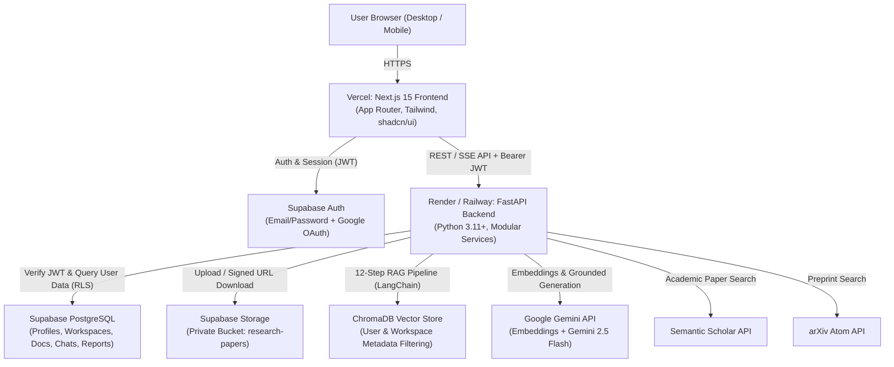

# ResearchMate AI — System Architecture (Stage 1)

## 1. Project Overview & Problem Statement

**ResearchMate AI** is an AI-powered academic research platform built for college students, researchers, and academics.

### Why a Basic Chatbot Is Insufficient
A standard LLM chatbot (like pasting text into a generic chat box) fails for serious academic work because:
1. **Context Window Limits & Cost**: Academic papers are 10–50+ pages long; passing multiple full papers into every prompt is slow, expensive, and degrades attention ("lost in the middle").
2. **Hallucinations Without Grounding**: General chatbots invent citations, page numbers, or methodology details when unsure.
3. **No Persistent Organization**: Chats are isolated from workspaces, PDFs, literature matrices, and live academic search APIs.
4. **No Multi-User Data Isolation**: A production SaaS needs authenticated workspaces, private storage, and per-user vector isolation.

### How ResearchMate AI Solves This
ResearchMate AI combines:
- **True Retrieval-Augmented Generation (RAG)** via LangChain + ChromaDB + dense vector embeddings so answers are grounded in retrieved document chunks with exact **document name + page number citations**.
- **Google Gemini LLM** for grounded Q&A, structured paper summarization, multi-paper literature comparison, and research gap analysis.
- **Live Academic Discovery** via **Semantic Scholar API** and **arXiv API** proxied cleanly through FastAPI.
- **Supabase** (PostgreSQL + Row Level Security, Auth, Storage) for secure multi-tenant isolation and persistence.

---

## 2. High-Level System Architecture

---

## 3. Complete 12-Step RAG Pipeline Architecture

```mermaid
flowchart LR
    S1["1. PDF Ingestion\n(Upload + Validation)"] --> S2["2. Text Extraction\n(PyMuPDF page-by-page + OCR fallback)"]
    S2 --> S3["3. Text Cleaning\n(Normalize whitespace, strip headers/artifacts)"]
    S3 --> S4["4. Text Chunking\n(LangChain RecursiveCharacterTextSplitter\nwith page metadata)"]
    S4 --> S5["5. Embedding Generation\n(Dense vectors per chunk)"]
    S5 --> S6["6. Vector Storage\n(ChromaDB with user_id, workspace_id, doc_id, page)"]

    Q["User Question"] --> S7["7. Semantic Similarity Search\n(Embed query + filter by user_id & workspace_id)"]
    S6 --> S7
    S7 --> S8["8. Relevant Chunk Retrieval\n(Top-K chunks + similarity score threshold)"]
    S8 --> S9["9. Context Construction\n(Format chunks with [Doc Title, Page X] + chat history)"]
    S9 --> S10["10. Gemini LLM Invocation\n(Grounded system prompt + strict anti-hallucination rules)"]
    S10 --> S11["11. Response Generation\n(Streamed/structured answer)"]
    S11 --> S12["12. Source Citations\n(Return clickable document & page references)"]
```

### Strict RAG Rules Enforced in Design
1. **Never pass full PDFs into chat prompts** — always retrieve top-$k$ relevant chunks from ChromaDB.
2. **Tenant Isolation** — every ChromaDB query filters by `where={"user_id": current_user.id, "workspace_id": workspace_id}` (and optional `document_ids`).
3. **Abstention on Insufficient Context** — if retrieved chunks do not meet relevance or lack the answer, the prompt instructs Gemini to explicitly state that the uploaded papers do not contain the answer.
4. **Metadata Preservation** — every chunk carries `user_id`, `workspace_id`, `document_id`, `document_title`, `page_number`, and `chunk_index`.

---

## 4. Security & Multi-Tenant Isolation Model

1. **Authentication Flow**:
   - Frontend authenticates with Supabase Auth (`@supabase/ssr`), obtaining a signed JWT access token.
   - Protected Next.js routes (`/dashboard`, `/workspaces`, `/chat`, `/documents`, etc.) check session via Next.js Middleware; unauthenticated visitors are redirected to `/login`.
   - Public routes (`/`, `/login`, `/register`) remain accessible without login so shared links work immediately.
2. **Backend Verification**:
   - Every private FastAPI endpoint requires `Authorization: Bearer <supabase_jwt>`.
   - FastAPI verifies the JWT signature / validates against Supabase Auth and extracts `user_id`.
3. **Database Row Level Security (RLS)**:
   - Every user-owned table in Supabase PostgreSQL enforces `auth.uid() = user_id`.
4. **File Upload & Storage Security**:
   - Validate MIME type (`application/pdf`), magic bytes (`%PDF-`), and size limit (e.g., 25 MB max).
   - Files are stored in a private Supabase Storage bucket under `{user_id}/{workspace_id}/{document_id}.pdf`.
5. **Secrets Management**:
   - `GEMINI_API_KEY`, `SUPABASE_SERVICE_ROLE_KEY`, and `SEMANTIC_SCHOLAR_API_KEY` live strictly on the backend environment. Never exposed in `NEXT_PUBLIC_*` variables.

---

## 5. Core Feature Modules & Data Flow

| Module | Primary Purpose | Backend Service | Database Tables |
| :--- | :--- | :--- | :--- |
| **Auth & Profile** | Registration, login, Google OAuth, profile preferences | `auth.py`, `profile.py` | `profiles` |
| **Workspaces** | Organize papers, chats, summaries, reports per topic | `workspaces.py` | `workspaces` |
| **PDF Ingestion** | Upload, validate, extract text (+OCR), chunk, embed | `pdf_processor.py`, `rag_pipeline.py` | `documents` |
| **AI Research Chat** | Grounded RAG Q&A with history & page citations | `rag_pipeline.py`, `llm_service.py` | `research_sessions`, `chat_messages` |
| **Paper Summariser** | 9-section structured academic summary | `llm_service.py` | `document_summaries` |
| **Literature Review** | Multi-paper structured comparison matrix | `analysis_service.py` | `literature_reviews` |
| **Research Gap Analysis** | Shared limitations, evidence-backed vs AI-suggested gaps | `analysis_service.py` | `research_gap_reports` |
| **Academic Discovery** | Live search on Semantic Scholar & arXiv + save | `academic_apis.py` | `saved_papers` |
| **Export Engine** | Generate clean downloadable PDF and CSV reports | `export_service.py` | Reads summaries, reviews, gaps |

---

## 6. Deployment & Persistence Strategy

- **Frontend (Vercel)**: Next.js App Router deployed with automatic HTTPS, global CDN, and Open Graph metadata for WhatsApp/Instagram mobile link previews.
- **Backend (Render or Railway)**: FastAPI container/service deployed with HTTPS, CORS locked to the Vercel production URL + local dev origin, and rate limiting.
- **Database & File Storage (Supabase)**: Managed PostgreSQL + Auth + S3-backed Storage (persistent across all redeploys).
- **Vector Store Persistence (ChromaDB)**:
  - Configured via `CHROMA_MODE`:
    - `persistent` (with mounted persistent disk on Railway/Render, or local dev directory)
    - `cloud` / `http` (Chroma Cloud or remote Chroma server for stateless containers)
  - Note: Avoiding local ephemeral disk in production ensures indexed embeddings survive server restarts and redeployments.
